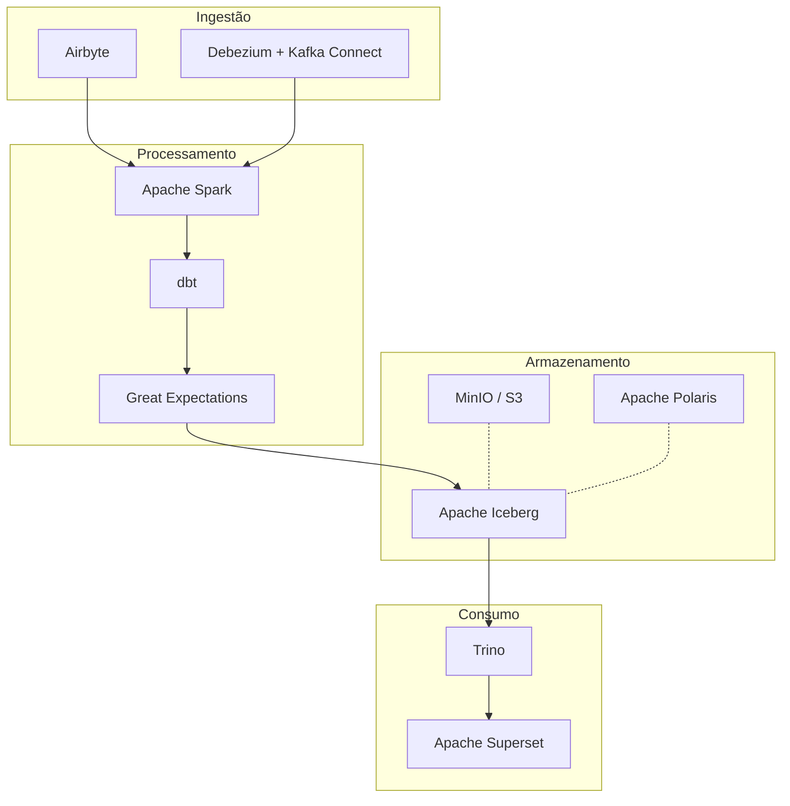
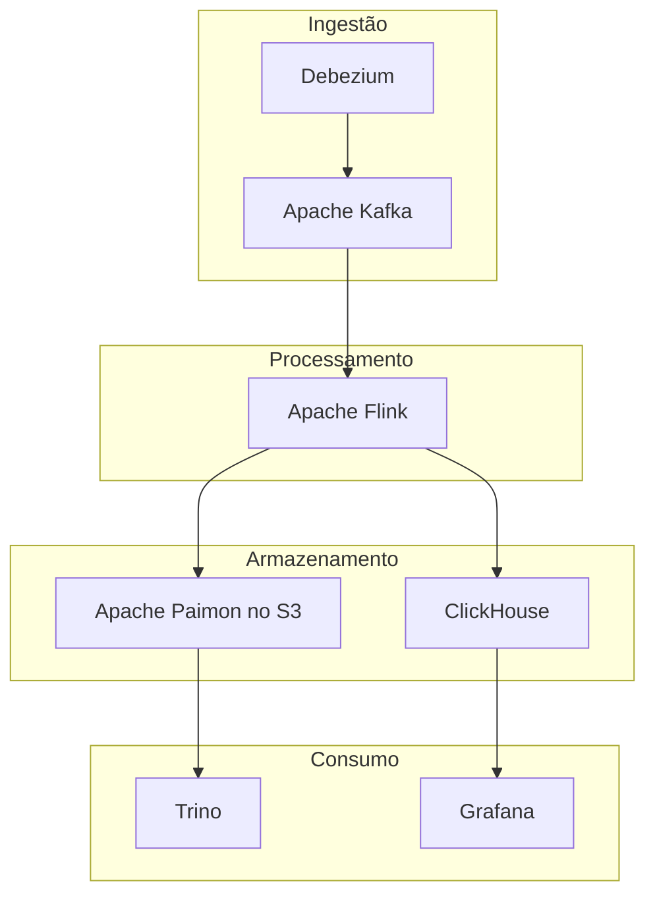
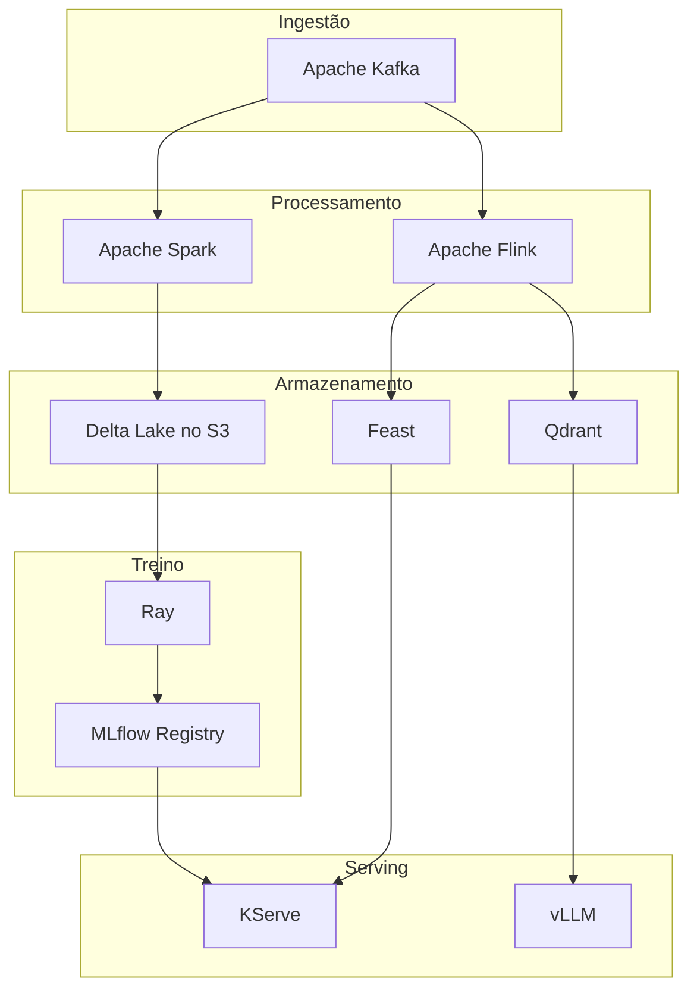

| Categoria | Ferramentas / Tecnologias | Uso principal |
|---|---|---|
| **Machine Learning** | MLflow, Kubeflow, Feast, Ray, TensorFlow, PyTorch, Scikit-learn, XGBoost, LightGBM | Treino, tracking, serving, feature store e MLOps |
| **Data Science / Analytics** | Python, Jupyter, Pandas, Polars, NumPy, SciPy, R, Apache Arrow | Exploração de dados, análise estatística e preparação de dados |
| **BI / Analytics** | Apache Superset, Metabase, Grafana, Power BI, Tableau | Dashboards, exploração e visualização de dados |
| **Engenharia de Dados** | Apache Spark, Apache Flink, Apache Beam, Apache Kafka, dbt | Processamento de dados, pipelines e transformações |
| **Ingestão / CDC** | Apache Kafka, Debezium, Kafka Connect, Apache NiFi, Airbyte, Fivetran | Ingestão de dados, CDC e integração de dados |
| **Orquestração de workflows** | Apache Airflow, Dagster, Prefect, Argo Workflows | Orquestração de pipelines e workflows |
| **Transformação de dados** | dbt, Apache Spark, SQLMesh, Dataform | Transformação, modelagem e ELT |
| **Qualidade de dados** | Great Expectations, Soda, dbt Tests, Deequ | Validação e checagens de qualidade |
| **Catálogo / Governança** | OpenMetadata, DataHub, Apache Atlas, Amundsen, OpenLineage | Catálogo de dados, linhagem e governança |
| **Armazenamento do data lake** | Amazon S3, MinIO, Google Cloud Storage, Azure Data Lake Storage | Object storage e data lake |
| **Formatos de arquivo** | Apache Parquet, Apache ORC, Apache Avro, Apache Arrow | Formatos de armazenamento e intercâmbio de dados |
| **Formatos de tabela abertos** | Apache Iceberg, Apache Hudi, Delta Lake, Apache Paimon | Tabelas ACID, evolução de schema, snapshots e time travel |
| **Catálogo de lakehouse** | Apache Polaris, Project Nessie, AWS Glue Catalog, Hive Metastore | Catálogo de tabelas e gestão de metadados |
| **Engines de consulta** | Trino, Presto, DuckDB, ClickHouse, Apache Doris, StarRocks | Analytics em SQL e OLAP |
| **Plataformas de lakehouse** | Databricks, Dremio, Starburst, Snowflake | Plataformas de data lakehouse e analytics |
| **Feature Store** | Feast, Hopsworks, Tecton | Gestão e serving de features de ML |
| **Pipelines de ML** | Kubeflow Pipelines, MLflow, Airflow, Metaflow, Flyte | Pipelines de machine learning |
| **Model Serving** | KServe, Seldon, NVIDIA Triton, Ray Serve, BentoML, vLLM | Inferência e serving de modelos |
| **Experiment Tracking** | MLflow, Weights & Biases, Neptune, Comet | Acompanhamento de experimentos e métricas |
| **Model Registry** | MLflow, Kubeflow, Vertex AI, SageMaker, Azure ML | Versionamento e ciclo de vida de modelos |
| **Bancos vetoriais** | Qdrant, Milvus, Weaviate, pgvector, Pinecone | Embeddings, busca semântica e RAG |
| **Streaming / Processamento de eventos** | Apache Kafka, Apache Flink, Redpanda, Apache Pulsar | Processamento de dados em tempo real |
| **Data Warehouse** | Snowflake, BigQuery, Redshift, ClickHouse, DuckDB | Analytics estruturado e OLAP |
| **Observabilidade de dados** | OpenTelemetry, Grafana, Prometheus, OpenLineage, Marquez | Observabilidade de dados e pipelines |

## Arquiteturas de referência

Três jeitos de ligar as ferramentas acima num stack que funciona. Todas têm as
mesmas três camadas, ingestão, processamento e armazenamento, mais o que quer
que consuma o resultado.

### 1. Lakehouse em batch

ELT noturno e de hora em hora. O padrão quando a latência é medida em horas.

O Apache Airflow fica fora do desenho, disparando cada seta acima.

### 2. Streaming

Segundos em vez de horas. Dois ramos saindo de um único job: a tabela para o
histórico, o store OLAP para o dashboard.

O Airflow continua necessário aqui, não para agendar o job, mas para rodar a
compactação e a expiração de snapshots que a tabela precisa, porque o job nunca
para de escrever.

### 3. ML e inferência

Features escritas pelo mesmo pipeline que alimenta o treino, e um modelo servido
a partir de um registry.

## Repositórios oficiais

- [Airbyte](https://github.com/airbytehq/airbyte): ELT baseado em conectores para carregar dados num warehouse ou lake.
- [Amundsen](https://github.com/amundsen-io/amundsen): Descoberta de dados e busca de metadados para analistas.
- [Apache Airflow](https://github.com/apache/airflow): Agenda e monitora pipelines escritos como DAGs em Python.
- [Apache Arrow](https://github.com/apache/arrow): Formato colunar em memória compartilhado entre engines e linguagens.
- [Apache Atlas](https://github.com/apache/atlas): Governança de metadados e linhagem para o ecossistema Hadoop.
- [Apache Avro](https://github.com/apache/avro): Formato de serialização orientado a linhas que carrega o próprio schema.
- [Apache Beam](https://github.com/apache/beam): Um único modelo de pipeline que roda em várias engines de batch e streaming.
- [Apache Doris](https://github.com/apache/doris): Banco analítico MPP voltado a relatórios em tempo real.
- [Apache Flink](https://github.com/apache/flink): Processamento de streams com estado, event time e exactly-once.
- [Apache Hudi](https://github.com/apache/hudi): Formato de tabela de lake com upserts e leituras incrementais.
- [Apache Iceberg](https://github.com/apache/iceberg): Formato de tabela aberto com commits ACID, evolução de schema e time travel.
- [Apache Kafka](https://github.com/apache/kafka): Log distribuído para publicar e consumir streams de eventos.
- [Apache NiFi](https://github.com/apache/nifi): Roteamento e transformação baseados em fluxo, com editor visual.
- [Apache ORC](https://github.com/apache/orc): Formato de arquivo colunar feito para leituras grandes no estilo Hive.
- [Apache Paimon](https://github.com/apache/paimon): Formato de tabela de lake projetado para ser escrito continuamente pelo Flink.
- [Apache Parquet](https://github.com/apache/parquet-format): O formato de arquivo colunar em que a maior parte do lake é armazenada.
- [Apache Polaris](https://github.com/apache/polaris): Catálogo aberto para que várias engines vejam as mesmas tabelas Iceberg.
- [Apache Pulsar](https://github.com/apache/pulsar): Mensageria e streaming com armazenamento separado do serving.
- [Apache Spark](https://github.com/apache/spark): Engine geral para batch, SQL e ML sobre grandes volumes de dados.
- [Apache Superset](https://github.com/apache/superset): BI web com dashboards e exploração em SQL.
- [Argo Workflows](https://github.com/argoproj/argo-workflows): Roda workflows nativos de contêiner como objetos do Kubernetes.
- [BentoML](https://github.com/bentoml/BentoML): Empacota um modelo e suas dependências num serviço.
- [ClickHouse](https://github.com/ClickHouse/ClickHouse): Column store para consultas analíticas rápidas em escala.
- [Dagster](https://github.com/dagster-io/dagster): Orquestrador construído em torno de data assets em vez de tarefas.
- [Dataform](https://github.com/dataform-co/dataform): Workflows de transformação em SQL com gestão de dependências.
- [DataHub](https://github.com/datahub-project/datahub): Plataforma de metadados para catálogo, linhagem e ownership.
- [dbt](https://github.com/dbt-labs/dbt-core): Transforma selects em SQL em modelos testados, documentados e versionados.
- [Debezium](https://github.com/debezium/debezium): Lê os logs de mudança do banco e os publica como eventos.
- [Deequ](https://github.com/awslabs/deequ): Checagens de qualidade de dados expressas como jobs Spark.
- [Delta Lake](https://github.com/delta-io/delta): Camada de armazenamento transacional sobre arquivos Parquet.
- [Dremio](https://github.com/dremio/dremio-oss): Engine de consulta e camada semântica sobre o armazenamento do lake.
- [DuckDB](https://github.com/duckdb/duckdb): Banco analítico que roda dentro do seu processo, sem servidor.
- [Feast](https://github.com/feast-dev/feast): Feature store que serve as mesmas features para treino e inferência.
- [Flyte](https://github.com/flyteorg/flyte): Workflows tipados e versionados para dados e ML no Kubernetes.
- [Grafana](https://github.com/grafana/grafana): Dashboards sobre métricas, logs e traces.
- [Great Expectations](https://github.com/fivetran/great_expectations): Declara expectativas sobre os dados e as valida.
- [Hive Metastore](https://github.com/apache/hive): O catálogo de tabelas e partições que muitas engines ainda leem.
- [Hopsworks](https://github.com/logicalclocks/hopsworks): Feature store e plataforma de ML.
- [Jupyter](https://github.com/jupyter/notebook): Notebooks para análise interativa.
- [KServe](https://github.com/kserve/kserve): Serve modelos no Kubernetes com autoscaling e canaries.
- [Kubeflow](https://github.com/kubeflow/kubeflow): Plataforma de ML montada a partir de componentes do Kubernetes.
- [Kubeflow Pipelines](https://github.com/kubeflow/pipelines): Compõe e executa pipelines de ML como contêineres.
- [LightGBM](https://github.com/lightgbm-org/LightGBM): Gradient boosting otimizado para velocidade em dados tabulares grandes.
- [Marquez](https://github.com/MarquezProject/marquez): Servidor de referência que coleta e armazena eventos OpenLineage.
- [Metabase](https://github.com/metabase/metabase): BI que deixa quem não é engenheiro fazer perguntas ao banco.
- [Metaflow](https://github.com/Netflix/metaflow): Workflows em Python para data science, da Netflix.
- [Milvus](https://github.com/milvus-io/milvus): Banco vetorial para busca por similaridade em escala.
- [MinIO](https://github.com/minio/minio): Object storage compatível com S3 que você mesmo roda.
- [MLflow](https://github.com/mlflow/mlflow): Acompanha experimentos, empacota modelos e mantém o registry.
- [NumPy](https://github.com/numpy/numpy): Arrays e computação numérica, a base do stack Python.
- [NVIDIA Triton](https://github.com/triton-inference-server/server): Servidor de inferência para modelos em GPU e CPU.
- [OpenLineage](https://github.com/OpenLineage/OpenLineage): Padrão aberto para pipelines reportarem o que leram e escreveram.
- [OpenMetadata](https://github.com/open-metadata/OpenMetadata): Catálogo, linhagem, qualidade e governança num lugar só.
- [OpenTelemetry](https://github.com/open-telemetry/opentelemetry-specification): Padrão neutro de fornecedor para traces, métricas e logs.
- [Pandas](https://github.com/pandas-dev/pandas): DataFrames para manipulação de dados em Python.
- [pgvector](https://github.com/pgvector/pgvector): Tipos e índices vetoriais dentro do PostgreSQL.
- [Polars](https://github.com/pola-rs/polars): DataFrames rápidos escritos em Rust, com engine de consulta lazy.
- [Prefect](https://github.com/PrefectHQ/prefect): Orquestração para workflows em Python, feita para execuções dinâmicas.
- [Presto](https://github.com/prestodb/presto): Engine SQL distribuída que consulta os dados onde eles estão.
- [Project Nessie](https://github.com/projectnessie/nessie): Branches e commits no estilo Git para tabelas do lake.
- [Prometheus](https://github.com/prometheus/prometheus): Banco de séries temporais e alertas para métricas.
- [Python](https://github.com/python/cpython): A linguagem em que a maior parte deste stack é escrita e operada.
- [PyTorch](https://github.com/pytorch/pytorch): Framework de deep learning com grafos dinâmicos.
- [Qdrant](https://github.com/qdrant/qdrant): Engine de busca vetorial com filtros, escrita em Rust.
- [R](https://github.com/r-devel/r-svn): Linguagem e ambiente para estatística.
- [Ray](https://github.com/ray-project/ray): Runtime distribuído em Python para treino, tuning e serving.
- [Redpanda](https://github.com/redpanda-data/redpanda): Broker compatível com Kafka sem JVM e sem ZooKeeper.
- [Scikit-learn](https://github.com/scikit-learn/scikit-learn): Algoritmos clássicos de machine learning em Python.
- [SciPy](https://github.com/scipy/scipy): Computação científica construída sobre o NumPy.
- [Seldon](https://github.com/SeldonIO/seldon-core): Faz deploy e monitora modelos no Kubernetes.
- [Soda](https://github.com/sodadata/soda-core): Checagens de qualidade de dados escritas como regras legíveis.
- [SQLMesh](https://github.com/SQLMesh/sqlmesh): Transformações com linhagem por coluna e ambientes virtuais.
- [StarRocks](https://github.com/StarRocks/starrocks): Banco OLAP MPP para consultas abaixo de um segundo sobre o lake.
- [TensorFlow](https://github.com/tensorflow/tensorflow): Framework de deep learning com toolchain de produção.
- [Trino](https://github.com/trinodb/trino): SQL distribuído que federa consultas entre muitas fontes.
- [vLLM](https://github.com/vllm-project/vllm): Serving de alto throughput para grandes modelos de linguagem.
- [Weaviate](https://github.com/weaviate/weaviate): Banco vetorial com módulos de embedding embutidos.
- [XGBoost](https://github.com/dmlc/xgboost): Biblioteca de gradient boosting, o cavalo de batalha dos dados tabulares.

O Kafka Connect vem dentro de apache/kafka, o dbt Tests dentro de dbt-core e o Ray Serve dentro de ray-project/ray, então compartilham os repositórios acima.

Sem repositório público, por serem proprietários ou serviços gerenciados: Power BI, Tableau, Fivetran, Amazon S3, Google Cloud Storage, Azure Data Lake Storage, AWS Glue Catalog, Databricks, Starburst, Snowflake, BigQuery, Redshift, Tecton, Pinecone, Weights & Biases, Neptune, Comet, Vertex AI, SageMaker e Azure ML.
