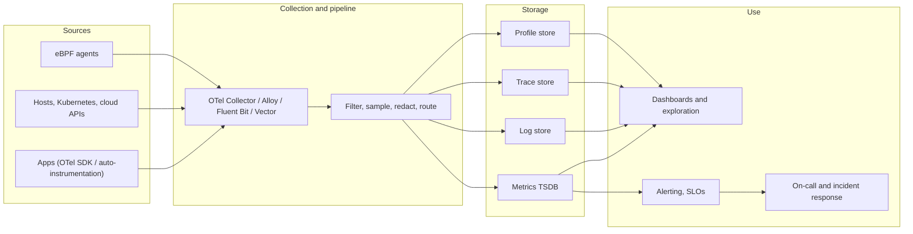

Observability is one of the most crowded markets in infrastructure software. There are open-source projects for every layer, a handful of public companies worth tens of billions, a long tail of startups, every cloud provider ships its own suite, and every few months someone buys someone else. For whoever has to pick a stack, or simply understand what the person in the meeting is talking about, the hard part is not finding options. It is knowing what each option actually *is*, and which ones are competing for the same job.

This post is a map. First, what the job is: the signals and the pipeline that carries them. Then, the standard that reorganized the whole market, OpenTelemetry. Then the open-source stack, layer by layer, followed by the commercial landscape, how vendors charge, where the bills explode, and a practical way to choose.

A warning about the commercial part: this market moves fast. Products get renamed, companies get acquired, pricing pages change every quarter. The categories and trade-offs below age well; specific details should be checked against the vendor's current documentation.

## Monitoring vs. observability

**Monitoring** answers questions you knew to ask in advance: is the CPU above 90%? Is the error rate above 1%? Is the disk filling up? You define the checks, you set thresholds, you get paged when they are crossed. It works well for failure modes you have already seen.

**Observability** is the ability to answer questions you did *not* know you would need to ask, from the outside of a system, without shipping new code. Why are checkout requests from one mobile app version, in one region, against one database shard, slow only since Tuesday's deploy? No dashboard was built for that question. An observable system lets you slice the data until the answer shows up.

The term comes from control theory, where a system is observable if its internal state can be inferred from its outputs. In software, it became popular around 2016–2018, pushed by people like Charity Majors (Honeycomb) and Cindy Sridharan, as microservices made the old "one server, one dashboard" model collapse. In practice the two words overlap and vendors use them interchangeably. What matters is the capability: rich, correlated, high-cardinality telemetry plus tools to explore it.

## The signals

Telemetry is usually described as "three pillars", although that framing has aged and there are now at least five signals worth knowing.

| Signal | What it is | Good for | Typical cost driver |
|---|---|---|---|
| **Metrics** | Numeric time series: counters, gauges, histograms, with labels | Trends, alerting, SLOs, capacity | Number of unique series (cardinality) |
| **Logs** | Timestamped records, ideally structured (JSON) | Detail about a specific event, audits, debugging | Volume ingested and retention |
| **Traces** | The path of one request across services, as a tree of spans | Latency breakdown, dependencies, distributed debugging | Number of spans, sampling rate |
| **Profiles** | Where CPU time and memory go, down to the function | Performance tuning, cost reduction | Sampling frequency, number of processes |
| **Events / RUM** | User sessions, frontend timings, errors, deploys, feature flags | User experience, change correlation | Sessions and events per month |

**Cardinality** is the concept that explains most observability bills and most outages of observability systems. A metric like `http_requests_total{service, method, status}` with 20 services, 5 methods and 10 status codes produces at most 1,000 series. Add a `user_id` label with a million users and you get a billion series. Metrics databases are built to handle many points per series, not unbounded numbers of series. That is why high-cardinality data (user IDs, request IDs, full URLs) belongs in traces and logs, or in tools specifically built for wide events, and not in metric labels.

The modern view, championed by Honeycomb and increasingly adopted by others, is that the pillars are just different projections of the same thing: **wide, structured events** with many attributes. A span with 50 attributes can be aggregated into metrics, filtered like a log, and assembled into a trace. Several newer backends (Honeycomb, ClickHouse-based stacks, Datadog's own event store) are built around that idea.

## OpenTelemetry: the center of gravity

Until the late 2010s, every vendor had its own agent and its own SDKs. Instrumenting your code with one vendor's library meant that switching vendors required rewriting instrumentation across every service. Lock-in was not in the contract; it was in the code.

[**OpenTelemetry**](https://opentelemetry.io/) (OTel) changed that. It was born in 2019 from the merger of two competing projects, OpenTracing and OpenCensus, under the CNCF, and it is today one of the most active projects in the foundation, second only to Kubernetes in contributors for a long time. Almost every vendor in this post now supports it, and most contribute to it. It is made of a few distinct pieces:

- **API and SDKs** for the main languages (Java, Go, Python, .NET, JavaScript, Ruby, PHP, Rust, C++, Swift and others), to create spans, metrics and logs in your code.
- **Auto-instrumentation**: agents and libraries that instrument common frameworks (HTTP servers, database drivers, gRPC, message queues) without code changes. The Java agent is the most mature; there is also a zero-code **eBPF-based instrumentation** (OBI, which grew out of Grafana's Beyla donation) that observes processes from the kernel.
- **OTLP**, the wire protocol (gRPC or HTTP, protobuf or JSON). It is the part that matters most for portability: if your backend speaks OTLP, you can change backends without touching applications.
- **The Collector**, a vendor-neutral agent and gateway that receives, processes (batching, filtering, sampling, redacting, enriching with Kubernetes metadata) and exports telemetry to any number of destinations. Most vendors also ship their own *distribution* of it.
- **Semantic conventions**, the shared vocabulary for attribute names (`http.request.method`, `db.system`, `k8s.pod.name`, and, more recently, `gen_ai.*` for LLM calls). Boring on paper, essential in practice: they are what lets a backend recognize "this is an HTTP server span" no matter who produced it.

Traces and metrics are stable across the main languages, logs are stable in most, and **profiles** are the newest signal, still maturing at the time of writing. The practical recommendation is simple: **instrument with OpenTelemetry, ship through a Collector, and treat the backend as a replaceable component.** That one decision is the biggest lever you have against lock-in.

## The pipeline, end to end

Every observability system, open-source or commercial, has the same shape. Knowing the layers is what lets you compare a "platform" with a "stack" of separate tools.

A commercial platform like Datadog or Dynatrace sells you all of these boxes, with their own agent at the start. An open-source stack assembles them from separate projects. Many real setups are hybrids: open-source collection, a commercial backend for some signals, self-hosted storage for others.

## The open-source stack

### Collection and pipelines

| Tool | Origin | What it does |
|---|---|---|
| **OpenTelemetry Collector** | CNCF | The vendor-neutral default for receiving, processing and exporting all signals |
| **Grafana Alloy** | Grafana Labs | Grafana's OTel Collector distribution (successor of Grafana Agent), with native Prometheus and Loki pipelines |
| **Fluent Bit / Fluentd** | CNCF (originally Treasure Data) | Lightweight log (and now metrics/traces) forwarder, the classic choice on Kubernetes |
| **Vector** | Timber, acquired by Datadog in 2021 | High-performance pipeline written in Rust, with a transformation language (VRL) |
| **Prometheus exporters** | Community | Node exporter, blackbox exporter, and hundreds of others exposing metrics for scraping |

### Metrics

[**Prometheus**](https://prometheus.io/) is the foundation. Created at SoundCloud in 2012 and the second project to graduate from the CNCF after Kubernetes, it introduced the pull model (scraping `/metrics` endpoints), the dimensional data model with labels, and **PromQL**, which became the de facto query language for metrics. Version 3.0, released in late 2024, brought native OTLP ingestion, UTF-8 metric names and a new UI.

A single Prometheus server is not designed for long-term storage or global views across clusters, so a family of projects grew around it, all compatible with PromQL and remote-write:

- **Thanos**: adds object-storage retention and a global query layer on top of existing Prometheus servers.
- **Cortex**: the original horizontally scalable, multi-tenant Prometheus.
- **Grafana Mimir**: Grafana Labs' fork and evolution of Cortex, the engine behind Grafana Cloud metrics.
- **VictoriaMetrics**: a separate, very resource-efficient implementation with its own query extensions (MetricsQL); its sibling projects VictoriaLogs and VictoriaTraces cover the other signals (more on the family below).
- **M3**: built at Uber, the technology that later became the core of Chronosphere.

### The Victoria family: metrics, logs and traces

[VictoriaMetrics](https://victoriametrics.com/) started as a single, fast time series database and grew into a full stack under the Apache 2.0 license. Its selling point across the board is efficiency: less RAM, less disk and fewer moving parts than the alternatives for the same volume, which is why it is popular with teams that self-host at scale.

| Component | Signal | What it is |
|---|---|---|
| [**VictoriaMetrics**](https://docs.victoriametrics.com/) | Metrics | Single-node or cluster TSDB; accepts Prometheus remote-write, OTLP, InfluxDB line protocol, Graphite and others; queried with PromQL or the superset MetricsQL |
| [**vmagent**](https://docs.victoriametrics.com/vmagent/) | Metrics | Lightweight scraper and forwarder, a drop-in replacement for Prometheus in agent mode |
| [**vmalert**](https://docs.victoriametrics.com/vmalert/) | Alerting | Evaluates Prometheus-compatible alerting and recording rules, sends to Alertmanager |
| [**VictoriaLogs**](https://docs.victoriametrics.com/victorialogs/) | Logs | Log database with its own query language (LogsQL), full-text search without needing to define indexes up front; a competitor to Loki and Elasticsearch for logs |
| [**VictoriaTraces**](https://docs.victoriametrics.com/victoriatraces/) | Traces | The newest member, a trace store built on the same storage ideas, with OTLP ingestion and a Jaeger-compatible query API |

There is also an enterprise edition (extra features like downsampling and multi-tenant controls, plus support) and a managed offering, VictoriaMetrics Cloud.

### Logs

- **Elasticsearch** and the ELK/Elastic Stack (Elasticsearch, Logstash, Kibana, Beats) defined log search for a decade. Its license change in 2021 led AWS to fork it as **OpenSearch**, now under the Linux Foundation. Elastic later added AGPL as an option, so Elasticsearch is again open source, but the two lineages remain separate.
- **Grafana Loki** indexes only labels, not the full text, which makes storage dramatically cheaper and queries over unindexed content slower. It fits well when you already know which stream to look at.
- **ClickHouse**, the columnar OLAP database, became a popular backend for logs and traces because it compresses well and scans fast. Several products are built on it (see below).
- Newer engines like **Quickwit** (acquired by Datadog in 2025) and **VictoriaLogs** target cheaper full-text search over object storage.

### Traces

- [**Jaeger**](https://www.jaegertracing.io/), created at Uber and a CNCF graduated project. Jaeger v2 is built on top of the OpenTelemetry Collector.
- [**Zipkin**](https://zipkin.io/), from Twitter, the original open-source tracer inspired by Google's Dapper paper.
- **Grafana Tempo**, a trace store that keeps spans in object storage and relies on TraceQL and links from logs and metrics instead of heavy indexing.

### Profiles

- **Grafana Pyroscope** (Grafana Labs acquired Pyroscope in 2023) and **Parca** (from Polar Signals) do continuous profiling, mostly with eBPF, so you can see flame graphs for production over time.

### Visualization and alerting

- **Grafana** is the de facto open-source dashboarding tool, connecting to almost any data source. Most of the stacks above use it as the front end.
- **Perses**, a CNCF project for dashboards-as-code with an open specification.
- **Alertmanager** handles Prometheus alerts: grouping, silencing, routing to email, Slack, PagerDuty and others.

### Grafana: OSS, Enterprise and Cloud

"Grafana" means three different things depending on who says it, and the difference matters when you compare prices or licenses.

| Edition | What you get | Who runs it |
|---|---|---|
| [**Grafana OSS**](https://grafana.com/oss/grafana/) | The open-source dashboard and alerting tool, AGPLv3 since 2021, with the open data source plugins (Prometheus, Loki, Tempo, Elasticsearch, PostgreSQL, CloudWatch and many others) | You |
| [**Grafana Enterprise**](https://grafana.com/products/enterprise/) | The same Grafana plus a commercial license: enterprise data source plugins (Splunk, Datadog, ServiceNow, Oracle, Snowflake and others), fine-grained access control, reporting, SAML and audit logs, and support | You, with a Grafana Labs contract |
| [**Grafana Cloud**](https://grafana.com/products/cloud/) | A managed platform: hosted Grafana plus Mimir, Loki, Tempo and Pyroscope as a service, with application and frontend observability, synthetic monitoring, k6 load testing, incident response and cost tools (Adaptive Metrics, Adaptive Logs). Free, Pro and Enterprise tiers | Grafana Labs |

The backends follow the same pattern: Mimir, Loki, Tempo and Pyroscope are open source (AGPLv3), and Grafana Labs sells self-managed enterprise versions of them alongside the cloud. On top of that, AWS and Azure sell their own managed Grafana ([Amazon Managed Grafana](https://aws.amazon.com/grafana/), [Azure Managed Grafana](https://azure.microsoft.com/products/managed-grafana)), which run Grafana but are not Grafana Cloud. The practical rule: start with OSS if you want to self-host and have the people for it, Cloud if you want the LGTM stack without operating it, Enterprise when you self-host but need the commercial plugins, compliance features or support.

### All-in-one open-source platforms

If you do not want to assemble six projects, there are open-source platforms that bundle everything, usually with a commercial cloud or enterprise edition behind them:

- [**SigNoz**](https://signoz.io/): OTel-native, built on ClickHouse, covering metrics, logs and traces in one UI.
- **ClickStack / HyperDX**: ClickHouse acquired HyperDX in 2025 and turned it into its own observability stack on top of the database.
- **OpenObserve**, **Uptrace** and **Coroot** (the last one with a strong eBPF and automatic root-cause angle).
- **Netdata**: per-second infrastructure monitoring with zero configuration.
- The classics, still running in a huge number of companies: **Zabbix**, **Nagios** and **Checkmk**, focused on infrastructure and network monitoring rather than distributed tracing.

### Ten more open-source projects worth knowing

| Project | What it does |
|---|---|
| [**Apache SkyWalking**](https://skywalking.apache.org/) | Full APM (traces, metrics, logs, service topology) with agents for Java, Go, Python and others; very popular in Asia |
| [**Pixie**](https://px.dev/) | CNCF project, eBPF-based, gives instant request-level visibility inside Kubernetes clusters with no instrumentation |
| [**Graylog**](https://graylog.org/) | Centralized log management and search, with a security (SIEM) edition on top |
| [**Telegraf + InfluxDB**](https://www.influxdata.com/) | Telegraf is a plugin-driven agent with hundreds of inputs; InfluxDB is the time series database it usually feeds |
| [**Graphite**](https://graphiteapp.org/) | The veteran metrics system (Carbon + Whisper) that Grafana was originally built to visualize; still everywhere in older stacks |
| [**Icinga**](https://icinga.com/) | A modern evolution of Nagios for infrastructure checks, with a web UI and an API |
| [**Uptime Kuma**](https://github.com/louislam/uptime-kuma) | Simple self-hosted uptime monitoring and status pages, a favorite of homelabs and small teams |
| [**Cilium Hubble**](https://github.com/cilium/hubble) | Network observability for Kubernetes using eBPF: who talks to whom, dropped packets, DNS and HTTP flows |
| [**Pyrra**](https://github.com/pyrra-dev/pyrra) | Defines SLOs on top of Prometheus and generates the recording rules, multi-burn-rate alerts and error budget dashboards |
| [**Odigos**](https://odigos.io/) | Automatic, zero-code OpenTelemetry instrumentation for Kubernetes workloads using eBPF |

### Open-source alerting, on-call and status pages

Collecting telemetry is half the job; the other half is getting the right alert to the right person and telling users what is going on. Alertmanager covers routing for Prometheus, but a lot of open-source tooling has grown around it and around the on-call problem in general.

| Project | What it does |
|---|---|
| [**GoAlert**](https://github.com/target/goalert) | On-call scheduling, escalation policies and notifications (SMS, voice, Slack, email), built and used in production by Target; a self-hosted alternative to PagerDuty |
| [**karma**](https://github.com/prymitive/karma) | Dashboard for Prometheus Alertmanager that aggregates alerts from many Alertmanager instances, groups and filters them, and manages silences in one view |
| [**kthxbye**](https://github.com/prymitive/kthxbye) | From the same author as karma; automatically extends Alertmanager silences while the alert is still firing, so acknowledged alerts do not come back in the middle of the night |
| [**Keep**](https://github.com/keephq/keep) | Alert management and AIOps: ingests alerts from many monitoring tools, deduplicates and correlates them, and runs workflows on top |
| [**Alerta**](https://github.com/alerta/alerta) | Alert consolidation and deduplication from multiple sources into one console and API |
| [**Robusta**](https://github.com/robusta-dev/robusta) | Enriches Prometheus alerts on Kubernetes with logs, events and graphs, and can run automated remediation |
| [**Moira**](https://github.com/moira-alert/moira) | Real-time alerting engine for Graphite-compatible metrics |
| [**ntfy**](https://github.com/binwiederhier/ntfy) | Simple self-hosted push notifications over HTTP, a common last mile for alerts to phones |
| [**Gatus**](https://github.com/TwiN/gatus) | Health checks for HTTP, TCP, DNS and others, with alerting and a status page, all configured in YAML |
| [**Upptime**](https://github.com/upptime/upptime) | Uptime monitor and status page that runs entirely on GitHub Actions, Issues and Pages |
| [**OpenStatus**](https://github.com/openstatusHQ/openstatus) | Open-source synthetic monitoring from multiple regions plus public status pages |
| [**Cachet**](https://github.com/cachethq/cachet) | The classic self-hosted status page system |
| [**awesome-status-pages**](https://github.com/ivbeg/awesome-status-pages) | A curated list of open-source and hosted status page tools and services, the best place to compare options |

Grafana Labs also had an open-source on-call product, [Grafana OnCall](https://github.com/grafana/oncall), but its repository was archived in March 2026 and on-call now lives in Grafana Cloud IRM, so GoAlert is the more natural self-hosted choice today.

## The commercial landscape

### The big platforms

These are the companies that sell the whole pipeline, from agent to on-call, with dozens of products on top.

| Company | Founded | Known for | Notes |
|---|---|---|---|
| [**Datadog**](https://www.datadoghq.com/) | 2010, New York | Breadth: infrastructure, APM, logs, RUM, security, LLM observability, all in one UI | Public since 2019; the market's reference point and frequently its most expensive line item |
| [**Dynatrace**](https://www.dynatrace.com/) | 2005, Austria (now Massachusetts) | OneAgent auto-discovery, the Smartscape topology map, Davis AI for root cause, the Grail data lakehouse | Strong in large enterprises and regulated industries |
| [**New Relic**](https://newrelic.com/) | 2008, San Francisco | One of the APM pioneers; moved to usage-based pricing (data ingested plus users) | Taken private in 2023 by Francisco Partners and TPG |
| [**Splunk**](https://www.splunk.com/) (Cisco) | 2003, San Francisco | The log search giant; Splunk Observability Cloud came from the SignalFx acquisition | Acquired by Cisco for about US$28 billion, closed in 2024; AppDynamics, which Cisco bought in 2017, now lives in the same portfolio |
| [**Elastic**](https://www.elastic.co/observability) | 2012, Amsterdam / San Francisco | Elastic Observability on top of Elasticsearch, strong in logs and search | Public; available self-managed or as Elastic Cloud |
| [**Grafana Labs**](https://grafana.com/) | 2014, New York | Grafana, Loki, Mimir, Tempo, Pyroscope (the "LGTM" stack), Grafana Cloud | The open-source-first platform; you can run the same stack yourself or pay them to run it |

What separates them in practice:

- **Datadog** wins on breadth and polish. Everything links to everything: a log line to its trace, the trace to the host, the host to the deploy. The trade-off is cost and a pricing model with many dimensions (per host, per GB, per million spans, per session, per custom metric), which makes bills hard to predict.
- **Dynatrace** wins on automation. Its agent discovers processes and dependencies on its own and its AI correlates problems into a single root cause. It is opinionated and enterprise-oriented, which some teams love and others find heavy.
- **New Relic** made its pricing simpler (a free tier, then mostly data volume and user seats) and is a common choice for mid-sized teams wanting a full platform at a more predictable price.
- **Splunk** is the default where security (SIEM) and logs already live there, and where Cisco is already a strategic vendor.
- **Elastic** fits where search and logs are the center, especially for teams that already operate Elasticsearch.
- **Grafana Labs** fits teams that want open standards and the option to self-host, with a managed version when operating it stops being worth it.

### The cloud providers

Every cloud has a native suite. It is often the cheapest place to start and almost always the deepest integration with that cloud's services, but it is weaker across multiple clouds and in cross-signal exploration.

| Cloud | Products |
|---|---|
| **AWS** | Amazon CloudWatch (metrics, logs, alarms, Application Signals), AWS X-Ray (traces), Amazon Managed Service for Prometheus, Amazon Managed Grafana, AWS Distro for OpenTelemetry |
| **Microsoft Azure** | Azure Monitor, Application Insights, Log Analytics (KQL), Azure Monitor managed service for Prometheus, Azure Managed Grafana |
| **Google Cloud** | Google Cloud Observability: Cloud Monitoring, Cloud Logging, Cloud Trace, Cloud Profiler, Google Cloud Managed Service for Prometheus |
| **Oracle / IBM** | OCI Observability and Management; IBM Instana (acquired in 2020) for APM |

A pattern worth noticing: the clouds increasingly offer *managed versions of the open-source stack* (managed Prometheus, managed Grafana, OTel distributions) instead of only their proprietary formats. That is OpenTelemetry and PromQL winning in practice.

### The challengers

A second layer of companies competes by being better at one thing, cheaper, or architecturally different.

| Company | Angle |
|---|---|
| [**Honeycomb**](https://www.honeycomb.io/) | High-cardinality, wide-event exploration; BubbleUp to find what is different about slow requests; strong influence on how the industry thinks about observability |
| **Chronosphere** | Built by the M3 team from Uber; cloud-native metrics and traces at scale with tools to control what data is kept. Palo Alto Networks announced its acquisition in late 2025 |
| **Coralogix** | Processes data in-stream and lets you choose per data type whether it is indexed, archived or only analyzed, to cut storage costs |
| **Sumo Logic** | Cloud log analytics and SIEM; taken private by Francisco Partners in 2023 |
| **Observe** | A data-lake approach to logs, metrics and traces on top of cheap storage, with relationships between datasets |
| **groundcover** | eBPF-based, runs its data plane inside your own cloud account (bring your own cloud) |
| **Axiom**, **Better Stack**, **Last9**, **Kloudfuse** | Cheaper ingest and storage, simpler pricing, or self-hosted-in-your-cloud deployments |
| **LogicMonitor**, **SolarWinds**, **Site24x7** | Infrastructure and network monitoring for traditional IT environments |
| [**Sentry**](https://sentry.io/welcome/) | Error tracking and application performance from the developer's side, open source at its core |
| [**SigNoz**](https://signoz.io/) | The commercial cloud and enterprise editions of the OTel-native, ClickHouse-based open-source platform |

### Sentry and SigNoz, a closer look

Two names that come up constantly in teams that start from the code rather than from the infrastructure:

- [**Sentry**](https://sentry.io/welcome/) started as an open-source error tracker in 2008 and became a company in 2012. Its core strength is the developer workflow: an exception arrives with the stack trace, the release, the commit that probably caused it, the user's breadcrumbs and, on the frontend, a session replay. It has grown into tracing, profiling, cron and uptime monitoring, but it remains the tool people reach for to answer "what broke in my code?" rather than "what is happening in my cluster?". It is offered as SaaS and as self-hosted under the Functional Source License (source available, becomes open source after two years).
- [**SigNoz**](https://signoz.io/) is an open-source, OpenTelemetry-native alternative to Datadog and New Relic, built on ClickHouse, with metrics, logs, traces, dashboards, alerts and exceptions in a single UI. You can self-host the community edition or use SigNoz Cloud. Because it speaks OTLP natively, moving to or away from it is mostly a change of Collector exporter.

### Ten more companies selling observability

| Company | Focus |
|---|---|
| [**Logz.io**](https://logz.io/) | Managed observability built on open source (OpenSearch, Prometheus, Jaeger), with AI-assisted investigation |
| [**Checkly**](https://www.checklyhq.com/) | Synthetic monitoring and API checks written as code with Playwright, run from CI and production |
| [**Catchpoint**](https://www.catchpoint.com/) | Internet performance and digital experience monitoring from a global network of vantage points |
| [**Kentik**](https://www.kentik.com/) | Network observability: flow data, BGP, cloud network traffic and DDoS detection |
| [**Lumigo**](https://lumigo.io/) | Observability and troubleshooting for serverless and Kubernetes applications |
| [**Middleware**](https://middleware.io/) | Full-stack, OTel-based observability platform positioned as a lower-cost alternative to the big platforms |
| [**Hydrolix**](https://hydrolix.io/) | Streaming data lake for logs at very high volume with long, cheap retention |
| [**Raygun**](https://raygun.com/) | Crash reporting, real user monitoring and APM for web and mobile applications |
| [**Embrace**](https://embrace.io/) | Mobile and web observability built on OpenTelemetry, focused on real user sessions |
| [**Nobl9**](https://www.nobl9.com/) | SLO platform that sits on top of existing data sources (Datadog, Prometheus, CloudWatch and others) to manage reliability targets and error budgets |

### Telemetry pipelines

A whole category exists just to sit *between* the sources and the backends: collect once, then filter, reduce, transform and route data to wherever it is cheapest or most useful. The main reason people buy them is cost: cutting noisy logs before they reach an expensive backend can pay for the pipeline many times over.

- **Cribl** (Stream, Edge, Search, Lake) is the leader in this category, very popular with Splunk customers.
- **Edge Delta**, **Mezmo** and **Observo** compete in the same space.
- The OTel Collector and Vector are the open-source equivalents, and many teams build exactly this with them.

### On-call and incident response

Telemetry is only useful if someone acts on it. This layer handles paging, escalation, incident coordination and post-mortems.

- **PagerDuty**, the long-time leader in on-call and alert routing.
- **incident.io** and **Rootly**, Slack-native incident management that grew fast in the 2020s.
- **Atlassian Opsgenie** has stopped being sold to new customers and Atlassian is moving its users into Jira Service Management and Compass, so anyone still on it has a migration on the calendar.
- Most big platforms (Datadog, Grafana Cloud, Splunk) now bundle their own on-call and incident features.

### LLM and AI observability

The newest category. Applications built on language models fail in new ways: a call succeeds with HTTP 200 and still returns a wrong or harmful answer, costs vary by tokens rather than by requests, and an "agent" can take dozens of steps before producing anything. Tools here capture prompts, completions, token counts, latency, cost and evaluation scores for each step.

- **Langfuse** (open source), **Arize Phoenix** (open source), **LangSmith** (from LangChain), **Helicone**, **Braintrust**, **Weights & Biases Weave** and **Traceloop/OpenLLMetry** are among the specialized tools.
- Datadog, Dynatrace, New Relic, Elastic and Grafana all added LLM monitoring to their platforms.
- OpenTelemetry has **GenAI semantic conventions**, so LLM calls can be traced like any other span, which should keep this category from becoming another lock-in island.

## A market built on acquisitions

A short and incomplete timeline helps explain why so many products today are bundles of formerly independent companies.

| Year | Event |
|---|---|
| 2017 | Cisco buys AppDynamics for about US$3.7 billion, just before its IPO |
| 2019 | Splunk buys SignalFx (later Splunk Observability Cloud); Datadog goes public; OpenTracing and OpenCensus merge into OpenTelemetry |
| 2020 | IBM buys Instana |
| 2021 | ServiceNow buys Lightstep; Datadog buys Timber (Vector); Elastic's license change leads to the OpenSearch fork |
| 2023 | New Relic and Sumo Logic are taken private; Grafana Labs buys Pyroscope |
| 2024 | Cisco closes the Splunk acquisition |
| 2025 | Datadog buys Quickwit and Eppo; ClickHouse buys HyperDX; Palo Alto Networks announces the acquisition of Chronosphere |

Two forces drive this. Platforms want to cover more signals and more use cases (security, product analytics, AI) under one contract. And security vendors are buying observability, because logs and runtime data are what both disciplines run on. The line between "observability" and "security operations" is getting thinner every year.

## How vendors charge, and where bills explode

Observability is notorious for bills that grow faster than the infrastructure they watch. Every vendor uses some mix of these units:

| Pricing unit | Used for | The trap |
|---|---|---|
| **Per host / per node / per container** | Infrastructure and APM agents | Autoscaling and short-lived nodes count; high-water-mark billing can charge you for the peak hour of the month |
| **Per GB ingested** | Logs, and often traces | Debug logs left on in production, verbose libraries, duplicated pipelines |
| **Per GB indexed or retained** | Logs | Long retention "just in case" on data nobody queries |
| **Per active series / custom metric** | Metrics | One high-cardinality label multiplies the bill overnight |
| **Per million spans / events** | Traces | Tracing 100% of traffic on a busy service |
| **Per user seat** | Platforms like New Relic | Restricting access to save money, so fewer people look at the data |
| **Per session** | RUM, session replay | Traffic spikes and bots |
| **Commitments and credits** | Enterprise contracts | Paying for committed volume you do not use, or overage rates when you exceed it |

The most-cited example is the roughly US$65 million Datadog bill mentioned on Datadog's own earnings call in 2023, widely reported to belong to Coinbase. It is extreme, but the dynamic behind it is common: nobody owns the cost of telemetry, so everybody emits as much as possible.

What actually keeps cost under control:

- **Sampling traces.** Head sampling (decide at the start of a request) is cheap; tail sampling (decide at the end, keeping all errors and slow requests) is smarter and is available in the OTel Collector.
- **Filtering at the pipeline.** Drop health-check logs, debug levels and duplicated fields before they reach a paid backend.
- **Turning logs into metrics.** If you only ever count a log line, emit a counter instead.
- **Tiered storage.** Keep a short hot window for fast search and archive the rest in object storage, rehydrating only when needed.
- **Watching cardinality.** Review new metric labels like you review database schema changes.
- **Showback.** Report telemetry cost per team or per service. Behavior changes as soon as the cost has an owner.

## How to choose

There is no best tool, only a best fit for a team's size, budget, skills and existing contracts. Some honest heuristics:

**Small team or startup.** Do not operate an observability stack yourself; it is a product in its own right. Use a managed service with a generous free tier (Grafana Cloud, New Relic, Honeycomb, SigNoz Cloud, Better Stack, or your cloud's native suite), instrument with OpenTelemetry, and revisit the decision when the bill starts to hurt.

**Mid-sized company, cost-conscious, comfortable with Kubernetes.** The open-source stack becomes attractive: Prometheus or VictoriaMetrics for metrics, Loki or a ClickHouse-based tool for logs, Tempo or Jaeger for traces, Grafana on top, everything fed by the OTel Collector. Budget for at least part of a team to run it. The software is free; the engineers, the storage and the 3 a.m. pages are not.

**Large enterprise, many teams and technologies.** A full platform (Datadog, Dynatrace, Splunk, New Relic, Elastic) often pays for itself in time saved, standard workflows and support contracts, as long as someone owns governance and cost. Put a pipeline (Collector or Cribl) in front of it from day one, so you keep the ability to negotiate or migrate.

**Regulated industry or strict data residency.** Look at self-hosted options, vendors that run inside your own cloud account (groundcover, Kloudfuse, some Grafana and Elastic deployments), and the data-processing locations of any SaaS before signing.

Whatever you choose, a few principles hold:

1. **Own your instrumentation.** OpenTelemetry in the code, OTLP on the wire. The backend should be a decision you can revisit.
2. **Own your pipeline.** A Collector layer between applications and vendors is cheap insurance against both lock-in and runaway cost.
3. **Start from questions, not from data.** Define SLOs for what users care about (latency, errors, availability of key journeys) and collect what you need to explain violations of them. More data is not more observability.
4. **Test the investigation, not the demo.** During a trial, take a real past incident and see how long it takes to find the cause in each tool.
5. **Calculate the bill at your real scale.** Ask for pricing on your current volume *and* on twice that. The difference between vendors often only appears at the second number.

## Where it is going

A few trends are visible across the whole market:

- **OpenTelemetry everywhere.** Proprietary agents are not disappearing, but vendors increasingly compete on what they do *with* the data rather than on how they collect it.
- **eBPF for zero-code visibility.** Network flows, latency per request and profiles collected from the kernel, without touching applications.
- **Profiling as the fourth signal.** Continuous profiling linked to traces, so you can go from "this request was slow" to "this function was the reason".
- **Columnar storage and object storage.** ClickHouse, Parquet and S3-style storage are pushing the cost per GB down and forcing incumbents to rethink pricing.
- **AI in the investigation loop.** Every platform now has an assistant that summarizes incidents, writes queries in natural language and proposes root causes. Useful when the data is good, misleading when it is not; it does not replace instrumentation.
- **Observability and security converging.** The same telemetry feeds detection and response, and acquisitions reflect that.

## Directory of links

Everything mentioned in this post, in one place.

### Open source

| Category | Projects |
|---|---|
| **Standards and collection** | [OpenTelemetry](https://opentelemetry.io/), [OTel Collector](https://opentelemetry.io/docs/collector/), [Grafana Alloy](https://grafana.com/oss/alloy-opentelemetry-collector/), [Fluent Bit](https://fluentbit.io/), [Vector](https://vector.dev/), [Telegraf](https://www.influxdata.com/time-series-platform/telegraf/), [Odigos](https://odigos.io/) |
| **Metrics** | [Prometheus](https://prometheus.io/), [Thanos](https://thanos.io/), [Cortex](https://cortexmetrics.io/), [Grafana Mimir](https://grafana.com/oss/mimir/), [VictoriaMetrics](https://victoriametrics.com/), [M3](https://m3db.io/), [InfluxDB](https://www.influxdata.com/), [Graphite](https://graphiteapp.org/) |
| **Logs** | [Grafana Loki](https://grafana.com/oss/loki/), [VictoriaLogs](https://docs.victoriametrics.com/victorialogs/), [OpenSearch](https://opensearch.org/), [Elasticsearch](https://www.elastic.co/elasticsearch), [Graylog](https://graylog.org/), [ClickHouse](https://clickhouse.com/) |
| **Traces** | [Jaeger](https://www.jaegertracing.io/), [Zipkin](https://zipkin.io/), [Grafana Tempo](https://grafana.com/oss/tempo/), [VictoriaTraces](https://docs.victoriametrics.com/victoriatraces/), [Apache SkyWalking](https://skywalking.apache.org/) |
| **Profiles and eBPF** | [Grafana Pyroscope](https://grafana.com/oss/pyroscope/), [Parca](https://www.parca.dev/), [Pixie](https://px.dev/), [Cilium Hubble](https://github.com/cilium/hubble) |
| **Visualization, alerting, SLOs** | [Grafana](https://grafana.com/oss/grafana/), [Perses](https://perses.dev/), [Alertmanager](https://prometheus.io/docs/alerting/latest/alertmanager/), [Pyrra](https://github.com/pyrra-dev/pyrra) |
| **All-in-one** | [SigNoz](https://signoz.io/), [ClickStack / HyperDX](https://clickhouse.com/use-cases/observability), [OpenObserve](https://openobserve.ai/), [Uptrace](https://uptrace.dev/), [Coroot](https://coroot.com/), [Netdata](https://www.netdata.cloud/) |
| **Infrastructure and uptime** | [Zabbix](https://www.zabbix.com/), [Nagios](https://www.nagios.org/), [Checkmk](https://checkmk.com/), [Icinga](https://icinga.com/), [Uptime Kuma](https://github.com/louislam/uptime-kuma) |
| **Alerting, on-call and status pages** | [GoAlert](https://github.com/target/goalert), [karma](https://github.com/prymitive/karma), [kthxbye](https://github.com/prymitive/kthxbye), [Keep](https://github.com/keephq/keep), [Alerta](https://github.com/alerta/alerta), [Robusta](https://github.com/robusta-dev/robusta), [Moira](https://github.com/moira-alert/moira), [ntfy](https://github.com/binwiederhier/ntfy), [Gatus](https://github.com/TwiN/gatus), [Upptime](https://github.com/upptime/upptime), [OpenStatus](https://github.com/openstatusHQ/openstatus), [Cachet](https://github.com/cachethq/cachet), [awesome-status-pages](https://github.com/ivbeg/awesome-status-pages) |
| **Errors and LLM** | [Sentry](https://github.com/getsentry/sentry) (self-hosted), [Langfuse](https://langfuse.com/), [Arize Phoenix](https://phoenix.arize.com/), [OpenLLMetry](https://github.com/traceloop/openllmetry) |

### Commercial

| Category | Companies |
|---|---|
| **Big platforms** | [Datadog](https://www.datadoghq.com/), [Dynatrace](https://www.dynatrace.com/), [New Relic](https://newrelic.com/), [Splunk](https://www.splunk.com/), [Elastic](https://www.elastic.co/observability), [Grafana Labs](https://grafana.com/) |
| **Cloud providers** | [Amazon CloudWatch](https://aws.amazon.com/cloudwatch/), [Azure Monitor](https://azure.microsoft.com/products/monitor), [Google Cloud Observability](https://cloud.google.com/products/observability), [IBM Instana](https://www.ibm.com/products/instana) |
| **Challengers** | [Honeycomb](https://www.honeycomb.io/), [Chronosphere](https://chronosphere.io/), [Coralogix](https://coralogix.com/), [Sumo Logic](https://www.sumologic.com/), [Observe](https://www.observeinc.com/), [groundcover](https://www.groundcover.com/), [Axiom](https://axiom.co/), [Better Stack](https://betterstack.com/), [Last9](https://last9.io/), [Kloudfuse](https://www.kloudfuse.com/), [SigNoz Cloud](https://signoz.io/) |
| **Developer-side and errors** | [Sentry](https://sentry.io/welcome/), [Raygun](https://raygun.com/), [Embrace](https://embrace.io/) |
| **Infrastructure and network** | [LogicMonitor](https://www.logicmonitor.com/), [SolarWinds](https://www.solarwinds.com/), [Site24x7](https://www.site24x7.com/), [Kentik](https://www.kentik.com/), [Catchpoint](https://www.catchpoint.com/) |
| **Other platforms** | [Logz.io](https://logz.io/), [Middleware](https://middleware.io/), [Lumigo](https://lumigo.io/), [Hydrolix](https://hydrolix.io/), [Checkly](https://www.checklyhq.com/), [Nobl9](https://www.nobl9.com/) |
| **Pipelines** | [Cribl](https://cribl.io/), [Edge Delta](https://edgedelta.com/), [Mezmo](https://www.mezmo.com/) |
| **On-call and incidents** | [PagerDuty](https://www.pagerduty.com/), [incident.io](https://incident.io/), [Rootly](https://rootly.com/) |
| **LLM observability** | [LangSmith](https://www.langchain.com/langsmith), [Helicone](https://www.helicone.ai/), [Braintrust](https://www.braintrust.dev/), [Arize](https://arize.com/) |

## Closing

Under all the brand names, the job is the same: get signals out of systems, move them somewhere affordable, and turn them into answers fast enough to matter when something breaks. The tools that last are the ones that respect that job and do not trap your data. Pick a stack that fits your team today, keep instrumentation and pipelines in open standards, and treat telemetry like any other production system, with an owner, a budget and a purpose.
